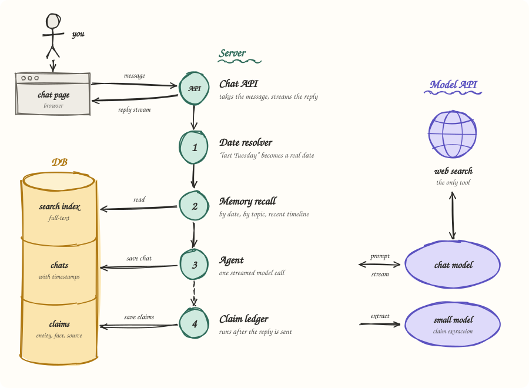

# Chat agent with web search and a memory for dates

A chat agent with one tool, web search. It remembers what you asked and when, so it can answer things like "last Tuesday I asked about Postgres hosting, has pricing changed?"

How it works and why: [DESIGN.md](DESIGN.md).

## Architecture


Memory is looked up before the model runs and handed over as context, so web search stays the only tool. The full reasoning is in [DESIGN.md](DESIGN.md).

## Run it
```bash
npm install
cp .env.example .env   # add GEMINI_API_KEY
npm run dev            # http://localhost:3000
```
Needs Node 20 or newer. The only key is `GEMINI_API_KEY` (free from Google AI Studio). The default chat model, `gemini-2.5-flash`, is the one with free Google Search; with billing on, set `CHAT_MODEL=gemini-3.8-flash`.

## Try the date questions without waiting a week
```bash
npm run seed
```
This adds three sample past chats (a CRM shortlist on Monday, Postgres hosting on Tuesday, a Node.js question on 3 November). It's demo data and only replaces its own rows.

You can also move the clock: set `FAKE_NOW=2026-11-20T10:00:00` in `.env` and the agent believes it's that day.

## Hosted demo
The repo deploys to Vercel as is; set `GEMINI_API_KEY` in the project's environment variables. Vercel has no disk that lasts, so the hosted copy keeps memory in `/tmp`: it starts from the sample chats on every cold start, forgets real chats when the instance recycles, and runs in UTC. Run it locally for memory that sticks.

## Check it
```bash
npm test        # date and memory logic, no key needed
npm run eval    # the task's sample questions against seeded memory, needs the key
```

## Where things are
| File | What it does |
|---|---|
| `src/agent.ts` | one turn: recall, model call, stream, save |
| `src/recall.ts` | builds the memory block for each question |
| `src/dates.ts` | "last Tuesday" to real dates |
| `src/ledger.ts` | writes down claims after each answer |
| `src/store.ts` | SQLite: chats and claims |
| `src/prompt.ts` | the two prompts |
| `src/routes.ts` | the three HTTP routes and streaming |
| `src/server.ts` | starts the server |
| `src/seed.ts` | the sample past chats |
| `public/index.html` | the chat page |
